# ML Observability Scaling

Companion repository for two studies by Bhavin Kotak (`kotak.bhavin@gmail.com` | `bhavin.kotak@ibm.com`) on statistical drift detection, false-discovery-rate control across model portfolios, and production alerting.



Interactive HTML version: [`docs/diagrams/observability-pipeline.html`](./docs/diagrams/observability-pipeline.html)

<!-- v2-release -->
## Version 2.0 study (November 2026)

Version 2.0 is a preregistered empirical and simulation study: *Scaling ML Observability from Pilot to Portfolio: Measured Drift-Detector Behavior and False-Alarm Control for Hundreds of Models* ([`v2/paper/main.pdf`](v2/paper/main.pdf)).

- Code, preregistration, logged runs, and tests: [`v2/`](v2/)
- Zenodo archive: [10.5281/zenodo.23970096](https://doi.org/10.5281/zenodo.23970096) (v1: [10.5281/zenodo.18445588](https://doi.org/10.5281/zenodo.18445588))
- Preregistered verdict: `SUPPORTED` (H1, H2, and H3)
- Key logged results: across a simulated portfolio of `N = 1,000` models with `20` features each, Benjamini-Hochberg control at `q = 0.05` cuts false feature-level alarms per day by `99.56%` (95% CI `[99.52%, 99.61%]`) relative to unadjusted `alpha = 0.05` thresholds while retaining `86.61%` (95% CI `[84.97%, 88.25%]`) of 3-day event recall. On no-drift real tabular features, the `PSI >= 0.1` rule-of-thumb false-alarm rate is `22.1` percentage points higher at `n = 100` than at `n = 2,000` (H2). On the Elec2 temporal stream, weekly feature-drift alarms and weekly accuracy-drop alarms show `kappa = 0.0` agreement (H3).
- Reproduce everything: `python v2/code/run_all.py` and `pytest v2/tests/test_core.py -v`

Every number in the v2 paper comes directly from logged outputs in `v2/results/`. Unsupported v1 claims were removed and listed in [`v2/REVIEW.md`](v2/REVIEW.md).
<!-- v2-release -->

## Reference library (`src/`)

The `src/` package contains the standalone v1 monitoring modules (*Scalable ML Observability: A Multi-Layered Architecture for Production Model Monitoring*): `DriftDetector` (PSI, Jensen-Shannon / KL divergence, two-sample Kolmogorov-Smirnov, and Wasserstein-1 distance), `MetricsCollector`, rule-based `AlertManager`, and `MonitoringDashboard`.

## Project layout

```
ml-observability-scaling/
├── docs/diagrams/              # Editorial pipeline diagram (.html + .svg)
├── v2/
│   ├── code/obsbench/          # Portfolio FDR simulator, detector benchmark, Elec2 study
│   ├── code/run_all.py         # End-to-end v2 reproduction entrypoint
│   ├── paper/                  # LaTeX source, tables, figures, and main.pdf
│   ├── preregistration.json    # Locked hypotheses H1-H3 and decision rules
│   ├── results/                # Logged CSV/JSON outputs and verdict.json
│   └── tests/test_core.py      # Statistical detector and BH/FDR unit tests
├── src/
│   ├── drift_detection.py      # PSICalculator, KLDivergenceCalculator, KSTestDetector, WassersteinDetector
│   ├── monitoring.py           # MetricsCollector, AlertManager, MonitoringDashboard
│   └── data_generators.py      # Synthetic drift stream generators
├── tests/test_observability.py # Unit tests for src/
└── requirements.txt
```

## Installation

```bash
python -m venv venv
source venv/bin/activate
pip install -r requirements.txt
```

## Quick start (`src/`)

### Drift detection

```python
from src.drift_detection import DriftDetector
import pandas as pd
import numpy as np

detector = DriftDetector()

reference_df = pd.DataFrame({
    'feature_1': np.random.normal(100, 15, 1000),
    'feature_2': np.random.normal(50, 10, 1000)
})

current_df = pd.DataFrame({
    'feature_1': np.random.normal(110, 20, 500),
    'feature_2': np.random.normal(50, 10, 500)
})

results = detector.detect_drift(reference_df, current_df)
print(f"Drifted features: {results['summary']['drifted_feature_names']}")
```

### Individual drift calculators

```python
from src.drift_detection import (
    PSICalculator, KSTestDetector, WassersteinDetector
)

reference = np.random.normal(100, 15, 1000)
current = np.random.normal(110, 15, 500)

print(f"PSI: {PSICalculator().calculate(reference, current).drift_score:.4f}")
print(f"KS p-value: {KSTestDetector().calculate(reference, current).p_value:.4f}")
print(f"Wasserstein: {WassersteinDetector().calculate(reference, current).drift_score:.4f}")
```

### Metrics, alert rules, and dashboard

```python
from src.monitoring import (
    MetricsCollector, AlertManager,
    MonitoringDashboard, AlertRule, AlertSeverity
)

collector = MetricsCollector()
collector.record_metric("prediction_latency", 0.05)
collector.record_metric("model_accuracy", 0.95)

alert_manager = AlertManager()
alert_manager.add_rule(AlertRule(
    name="high_latency",
    metric_name="prediction_latency",
    condition="gt",
    threshold=0.1,
    severity=AlertSeverity.WARNING,
    message_template="Latency {value:.3f}s exceeds {threshold}s"
))

for alert in alert_manager.check_metrics(collector):
    print(f"[{alert.severity.value}] {alert.message}")

dashboard = MonitoringDashboard(collector, alert_manager)
print(f"System health: {dashboard.get_overview()['health_status']}")
```

## Running studies and tests

```bash
# Reproduce the v2 portfolio study and run v2 tests
python v2/code/run_all.py
pytest v2/tests/test_core.py -v

# Run v1 demos and unit tests
python src/drift_detection.py
python src/monitoring.py
pytest tests/test_observability.py -v
```

## Detectors and alert levels

| Component | Summary |
|-----------|---------|
| `PSICalculator` | Quantile-binned Population Stability Index (`<0.1` minor, `>=0.25` large shift; sample-size dependent at small `n`, see H2) |
| `KLDivergenceCalculator` | Symmetric Jensen-Shannon divergence over binned histograms |
| `KSTestDetector` | Exact/asymptotic two-sample Kolmogorov-Smirnov test returning `D` and `p`-value |
| `WassersteinDetector` | First Wasserstein (earth mover's) distance between empirical distributions |
| `bh_reject` (`v2/code/obsbench/portfolio.py`) | Benjamini-Hochberg step-up procedure controlling daily portfolio FDR at `q = 0.05` |
| `AlertSeverity` | Four levels: `INFO`, `WARNING`, `CRITICAL`, and `EMERGENCY` |

## License

MIT License.
